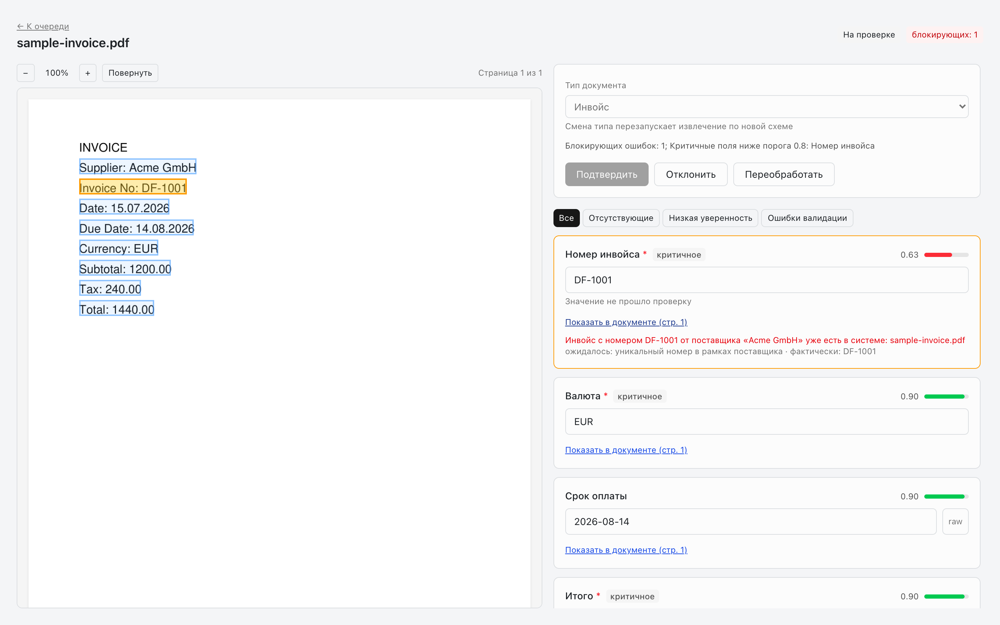

# Docflow Hub

Docflow Hub turns incoming business documents into checked, structured data. Files arrive by upload or from a watched folder; workers recognise the text, decide what kind of document it is, extract the fields and validate them. Documents that pass every check are approved automatically; the rest go to an operator, who sees each field next to the highlighted place on the page it came from, corrects it and exports the result.

```
Upload / watched folder → preprocess → OCR → classify → extract → validate → review → export
```



## Features

- **Document types:** invoices, bank statements (with an editable transaction table), tax letters and contracts; anything else is classified as Unknown.
- **Pipeline:** one BullMQ queue per stage with retries for transient failures. Corrupted, password-protected, empty and oversized files are rejected before any provider call and never retried.
- **Evidence for every value:** the model returns text verbatim, code normalises dates, numbers and currencies and matches each value to a bounding box on the page.
- **Validation and routing:** versioned rules and confidence thresholds per document schema. A document is approved automatically only with no blocking issues and every critical field above the threshold; otherwise it goes to review.
- **Operator console:** Queue, Review Workspace (fields beside the source page) and Execution Log (stage durations, attempts, errors, dead letters, manual retry).
- **Versions and duplicates:** a changed file at the same source path supersedes the previous version; an identical file is linked to the original.
- **Export:** canonical JSON with idempotent export keys. Google Sheets and Google Drive adapters exist but are currently disabled.
- **Audit:** append-only audit log enforced by database permissions; schema and rule versions are stored with every decision.
- **Roles:** administrator and operator.
- **Mock providers by default:** runs fully offline; Google Vision, OpenRouter and any OpenAI-compatible LLM are opt-in.

## Tech stack

| Layer     | Technology                                                     |
| --------- | -------------------------------------------------------------- |
| Frontend  | Next.js 16, React 19                                           |
| Backend   | Node.js 24, NestJS 11 (HTTP API and standalone worker), BullMQ |
| Storage   | PostgreSQL 18 (Drizzle ORM), Redis 7, MinIO (S3-compatible)    |
| Documents | PDF.js for text layers and page rendering, qpdf, Sharp         |
| AI        | Mock, Google Cloud Vision, OpenRouter / OpenAI-compatible LLMs |
| Tooling   | TypeScript 7, oxlint, Prettier, `node:test`, GitHub Actions    |

## Quick start

Requires **Node.js 24+**, **Docker** and **Docker Compose v2**.

```sh
cp example.env .env
npm ci
npm run dataset
docker compose up -d --build --wait
```

Open [localhost:3000](http://localhost:3000). Compose applies migrations and seeds two accounts before the API and worker start. `npm run dataset` builds the backend and generates the synthetic demo corpus in `evaluation/dataset/`.

| Demo account  | Login      | Password            |
| ------------- | ---------- | ------------------- |
| Administrator | `admin`    | `admin_password`    |
| Operator      | `operator` | `operator_password` |

These are the `SEED_*` values from `example.env`. Change them, the database passwords and `JWT_SECRET` before running anywhere other than your own machine.

To try it, upload a file from `evaluation/dataset/` or `scripts/fixtures/` (a clean invoice, an invoice with a sum mismatch, a corrupted and a password-protected PDF), or drop files into `docker/source-inbox/` for folder synchronisation.

| Service         | Port                   |
| --------------- | ---------------------- |
| Web console     | 3000 (`WEB_HOST_PORT`) |
| API             | 3001 (`API_HOST_PORT`) |
| MinIO / console | 9000 / 9001            |
| PostgreSQL      | 5432                   |
| Redis           | 6379                   |

Use `docker-compose` if your installation provides the standalone command. `docker compose logs -f api worker web` shows live logs; `docker compose down` stops the stack.

## Configuration

Copy `example.env` to `.env`. Startup validates every value and fails early on invalid combinations. Database URLs are derived from the `POSTGRES_*` values and `APP_DB_PASSWORD`.

| Variable                             | Default                      | Purpose                                                               |
| ------------------------------------ | ---------------------------- | --------------------------------------------------------------------- |
| `POSTGRES_USER`, `POSTGRES_PASSWORD` | `docflow_owner`, placeholder | Owner role: initialisation, migrations and seed only                  |
| `APP_DB_PASSWORD`                    | placeholder                  | Runtime role `docflow_app`; set only when the volume is first created |
| `MINIO_*`                            | local MinIO                  | Object storage; `MINIO_PUBLIC_URL` must be reachable by the browser   |
| `JWT_SECRET`, `JWT_EXPIRES_IN`       | placeholder, `8h`            | Session tokens                                                        |
| `OCR_PROVIDER`                       | `mock`                       | `mock` (PDF text layer), `google` or `openrouter`                     |
| `LLM_PROVIDER`                       | `mock`                       | `mock` or `openai_compatible` (OpenRouter, DeepSeek, …)               |
| `SOURCE_PROVIDER`                    | `local_folder`               | `none`, `local_folder` or `google_drive`                              |
| `EXPORT_DEFAULT_DESTINATION`         | `file_json`                  | `file_json` or `google_sheets`                                        |
| `QUEUE_CONCURRENCY_*`                | `4`, OCR and extract `2`     | Workers per pipeline stage                                            |
| `RETENTION_DAYS`, `ORPHAN_TTL_HOURS` | `90`, `24`                   | Deletion of deactivated versions and unreferenced files               |

The full list is in [`example.env`](example.env). Provider keys are stored as encrypted envelopes, never as plain environment values; see [Configuration](docs/configuration.md) for real providers, the OpenRouter preset and key provisioning.

## Development

Backend apps run from compiled output. For local development, run PostgreSQL, Redis and MinIO (for example `docker compose up -d postgres redis minio`), point `POSTGRES_HOST`, `REDIS_HOST` and `MINIO_ENDPOINT` in `.env` at `localhost`, then:

```sh
npm run build
npm run db:migrate && npm run db:seed
npm run build -- --watch   # keep backend output fresh
npm run dev:api            # in separate terminals
npm run dev:worker
npm run dev:web
```

Native worker execution needs qpdf (`brew install qpdf` or `apt-get install qpdf`); the Docker image installs it.

| Command                                   | What it does                                                              |
| ----------------------------------------- | ------------------------------------------------------------------------- |
| `npm run build` / `npm run typecheck`     | `tsc -b` across shared → core → api → worker (web: `next build`)          |
| `npm run lint`                            | oxlint                                                                    |
| `npm run format` / `npm run format:check` | Prettier write / check                                                    |
| `npm test`                                | Unit and provider tests; PostgreSQL suite when `TEST_DATABASE_URL` is set |
| `npm run test:review`                     | Browser regression of the Review Workspace (needs Chrome)                 |
| `npm run db:generate`                     | Generate a migration from the Drizzle schema                              |
| `npm run db:migrate` / `npm run db:seed`  | Apply migrations / upsert seed users (as the owner role)                  |
| `npm run dataset`                         | Regenerate the deterministic demo corpus                                  |
| `npm run eval`                            | Quality report over the labelled set → `evaluation/last-run.md`           |
| `npm run eval:performance`                | Performance sample → `evaluation/performance.md`                          |
| `npm run verify`                          | Security and delivery checks against a disposable stack                   |
| `npm run screenshots`                     | Capture delivery screenshots from a running stack                         |

`eval`, `verify` and `screenshots` talk to a real running stack and must point at a disposable one; they never start or reset Compose themselves. See the [runbook](docs/runbook.md#quality-and-performance-evaluation) before running them.

## Project structure

```
apps/
  web/              Next.js operator console: login, Queue, Review Workspace, Execution Log
  api/              NestJS HTTP API: auth, documents, review actions, schemas, export, events, runs
  worker/           NestJS BullMQ processors: preprocess, OCR, classify, extract, validate, sync, maintenance
packages/
  shared/           Framework-free contracts and pure logic (also bundled into the browser)
  core/             Infrastructure shared by api and worker: config, Drizzle schema, storage, queues, ingest
    drizzle/        SQL migrations
docker/             Dockerfiles, VPS override, Caddy, PostgreSQL init, deploy receiver, watched folder
scripts/            Dataset generator, evaluation, screenshots, tests, security checks, fixtures
evaluation/         Labelled dataset and committed quality, performance and security reports
output/pdf/         Extra synthetic samples with expected values
docs/               Documentation (see below)
secrets/            Encrypted integration credentials (git-ignored)
```

## Documentation

| Document                                         | Read it for                                                       |
| ------------------------------------------------ | ----------------------------------------------------------------- |
| [Test walkthrough (Russian)](docs/basic-flow.md) | Step-by-step scenarios through the console with the sample files  |
| [Architecture](docs/architecture.md)             | Services, processing flow, security and data integrity, providers |
| [Configuration](docs/configuration.md)           | All settings, real providers, encrypted credentials, admin API    |
| [Runbook](docs/runbook.md)                       | Start/stop, failures and recovery, evaluation, security checks    |
| [Demo VPS](docs/vps.md)                          | The demo server, autodeploy and manual recovery                   |
| [Known limitations](docs/known-limitations.md)   | What is mocked, deferred or unverified                            |
| [Design system](docs/design.md)                  | Interface principles, tokens, accessibility                       |
| [CLAUDE.md](CLAUDE.md)                           | Architecture invariants and configuration traps                   |
| [Evaluation report](evaluation/last-run.md)      | Latest quality run over the labelled set                          |
| [Demo video](docs/demo.webm)                     | Recorded walkthrough                                              |

`docs/archive/` holds the [specification completion plan](docs/archive/PLAN.md) and the [refactoring plan](docs/archive/refactoring.md) with their stage records. The requirements source is the external _Technical Specification No. 1 v2_; code comments reference its sections. The interface is in English. All demo documents are synthetic and contain no real personal data.

## Deployment

Pushes to `main` run CI in GitHub Actions (build, lint, format check, tests with PostgreSQL, web build, review regression) and then deploy to the demo VPS through a restricted SSH command. See [Demo VPS](docs/vps.md#github-autodeploy) and the [runbook](docs/runbook.md#production-deployment-script).
