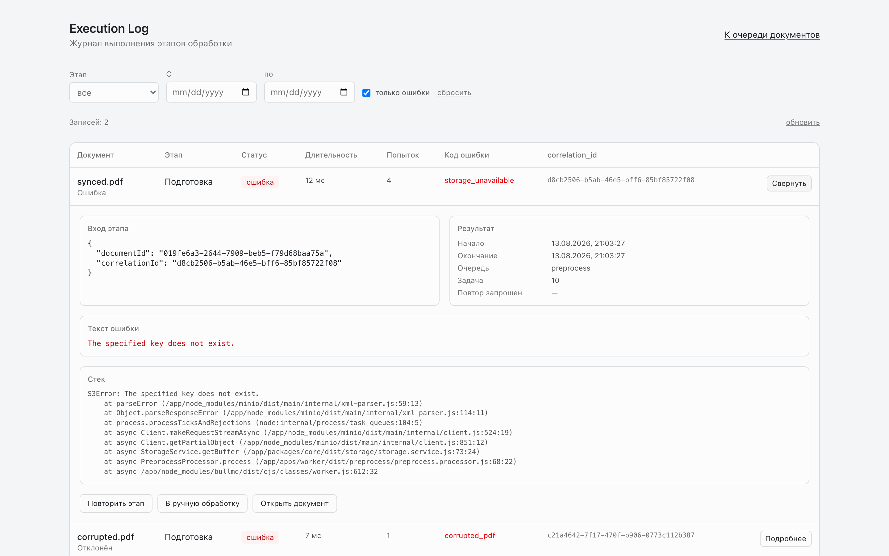
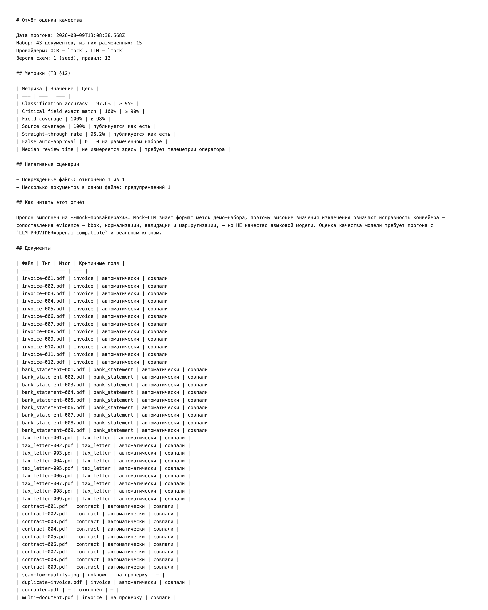

# Экраны

Снимки из состава поставки (ТЗ §16). Снимаются с живого стека командой
`npm run screenshots` — не рисуются вручную, поэтому всегда соответствуют
текущему коду.

## Review Workspace

Оригинал слева, извлечённые поля справа. Голубым обведены области-источники
всех найденных значений, оранжевым — область поля, выбранного ссылкой
«Показать в документе» (критерий приёмки 5). У каждого поля видна уверенность;
у «Номера инвойса» она 0.63 — ниже порога 0.8, и это указано текстом над
кнопками. Документ имеет блокирующую ошибку (повтор номера инвойса у того же
поставщика — единственная разрешённая ТЗ сверка между документами), поэтому
кнопка «Подтвердить» недоступна (критерий 6).

## Execution Log с повтором упавшей задачи

Журнал с включённым фильтром «только ошибки». Строка раскрыта: входные
параметры этапа, время и очередь, полный текст ошибки и стек. Ниже — действия:
повторить этап, перевести документ в ручную обработку, открыть документ.

Отказ воспроизведён удалением объекта из хранилища: `storage_unavailable` —
транзиентная ошибка, поэтому попытки исчерпались по политике 1с/5с/25с и
задача ушла в dead-letter queue. Вторая строка — `corrupted.pdf`: постоянный
дефект файла, документ отклонён, и записи в DLQ у него нет намеренно.

## Отчёт evaluation

Содержимое [evaluation/last-run.md](../../evaluation/last-run.md): метрики
ТЗ §12 с целевыми значениями, негативные сценарии и раздел «Как читать этот
отчёт», где прямо сказано, что прогон на mock-провайдерах измеряет
исправность конвейера, а не качество языковой модели.
